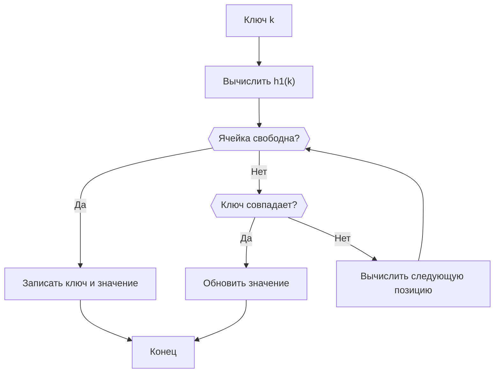

# Лабораторная работа № 5
## Хеширование и экспериментальное исследование методов разрешения коллизий

**Вариант:** 7  
**Дисциплина:** Теория алгоритмов  
**Направление подготовки:** 38.03.05 «Бизнес-информатика»  
**Курс:** 2  
**Язык реализации:** Python 3.10+

---

## Титульный лист

**[Наименование образовательной организации]**

**[Наименование кафедры]**

**ОТЧЁТ**  
по лабораторной работе № 5  
«Хеширование и экспериментальное исследование методов разрешения коллизий»

Вариант № 7

Выполнил(а): ___Иванюшкина Дарья Андреевна_______________________  
Группа: ___________БИ 2-3____________________  
Проверил(а): __________________________

**[Москва] — 2026**

---

## 1. Цель работы

Изучить принципы хеширования, реализовать хеш-таблицу с двумя способами разрешения коллизий и экспериментально исследовать влияние коэффициента заполнения и способа пробирования на производительность. Дополнительно — решить прикладную задачу подсчёта частот клиентов в журнале из одного миллиона записей и сравнить хеш-таблицу со списком.

## 2. Задание варианта 7

| Параметр | Значение |
|---|---:|
| Тип ключей | Случайные целые числа |
| Хеш-функция | Метод умножения |
| Коллизии | Линейное пробирование и двойное хеширование |
| Число элементов `n` | 50 000 |
| Размер таблицы `m` | 65 536 |
| Коэффициент заполнения `α = n/m` | 0,7629 |
| Дополнительное задание | В7 |

В рамках основной части реализованы операции вставки и поиска, подсчёт проб, измерение времени, сравнение с `dict`, а также сравнение качественной хеш-функции с заведомо неудачной.

## 3. Теоретические сведения и выбранные методы

### 3.1. Хеш-функция методом умножения

Для целого ключа `k` используется формула:

\[
h(k)=\left\lfloor m\cdot\{kA\}\right\rfloor,
\]

где `m` — размер таблицы, `A = (√5 − 1)/2 ≈ 0,618`, а фигурные скобки обозначают дробную часть числа.

Метод умножения выбран в соответствии с вариантом. Он распределяет целые ключи по ячейкам таблицы и не требует, чтобы размер таблицы был простым числом.

### 3.2. Линейное пробирование

Если ячейка с индексом `h(k)` занята, проверяется следующая ячейка:

\[
h_i(k)=(h(k)+i)\bmod m.
\]

Преимущество метода — простота реализации. Недостаток — первичная кластеризация: занятые ячейки образуют непрерывные участки, из-за чего последующие вставки и поиски могут требовать большего числа проб.

### 3.3. Двойное хеширование

При двойном хешировании шаг пробирования зависит от ключа:

\[
h_i(k)=(h_1(k)+i\cdot h_2(k))\bmod m.
\]

Первая функция `h1` — метод умножения. Вторая функция формирует нечётный шаг. Так как размер таблицы `65 536 = 2^16`, нечётный шаг взаимно прост с размером таблицы. Поэтому последовательность проб может пройти все ячейки, не зацикливаясь на подмножестве адресов.

Двойное хеширование уменьшает первичную кластеризацию по сравнению с линейным пробированием.

### 3.4. Коэффициент заполнения

\[
\alpha=\frac{n}{m}=\frac{50\,000}{65\,536}\approx 0,7629.
\]

Для открытой адресации коэффициент заполнения должен быть меньше единицы. При его увеличении число проб растёт. Теоретическая оценка числа проб при неуспешном поиске для равномерного хеширования:

\[
C_{\text{ср}}\approx\frac{1}{1-\alpha}.
\]

При приближении `α` к единице оценка резко возрастает.

### 3.5. Схема структуры данных

Все ключи и значения хранятся непосредственно в двух массивах: `keys` и `values`. Свободная ячейка обозначается специальным маркером `EMPTY`.



При линейном пробировании следующая позиция получается увеличением индекса на 1. При двойном хешировании индекс увеличивается на шаг `h2(k)`.

## 4. Листинг программы

Программа полностью реализует основной эксперимент и дополнительное задание В7. Для запуска сохраните листинг в файл `variant7_hashing.py` и выполните команду:

```bash
python variant7_hashing.py
```

```python
"""
Лабораторная работа № 5. Вариант 7.
Хеширование: метод умножения, линейное пробирование и двойное хеширование.
Дополнительное задание В7: анализ лога из 1 000 000 операций.
Python 3.10+
"""
import math
import random
import time
from collections import Counter
from pathlib import Path

M = 65_536
N = 50_000
A = (math.sqrt(5) - 1) / 2
SEED = 42


def multiplication_hash(key: int, m: int = M) -> int:
    """Метод умножения: floor(m * fractional_part(key * A))."""
    x = key * A
    return int(m * (x - math.floor(x)))


def poor_hash(key: int, m: int = M) -> int:
    """Заведомо неудачная функция: всего 10 исходных значений."""
    return (key % 10) % m


def second_hash(key: int, m: int = M) -> int:
    """
    Нечётный шаг для двойного хеширования.
    При m=2^r нечётный шаг взаимно прост с m, поэтому обходятся все ячейки.
    """
    x = key
    x ^= x >> 16
    x = (x * 0x7FEB352D) & 0xFFFFFFFF
    x ^= x >> 15
    return (x | 1) % m


class OpenAddressHashTable:
    EMPTY = object()

    def __init__(self, m=M, mode="linear", hash_func=multiplication_hash):
        self.m = m
        self.mode = mode
        self.hash_func = hash_func
        self.keys = [self.EMPTY] * m
        self.values = [None] * m
        self.n = 0
        self.probes = 0

    def _step(self, key):
        if self.mode == "linear":
            return 1
        if self.mode == "double":
            return second_hash(key, self.m)
        raise ValueError("Неизвестный способ пробирования")

    def insert(self, key, value):
        pos = self.hash_func(key, self.m)
        step = self._step(key)
        for _ in range(self.m):
            self.probes += 1
            current = self.keys[pos]
            if current is self.EMPTY:
                self.keys[pos] = key
                self.values[pos] = value
                self.n += 1
                return
            if current == key:
                self.values[pos] = value
                return
            pos = (pos + step) % self.m
        raise RuntimeError("Таблица переполнена")

    def search(self, key):
        pos = self.hash_func(key, self.m)
        step = self._step(key)
        for _ in range(self.m):
            self.probes += 1
            current = self.keys[pos]
            if current is self.EMPTY:
                return None
            if current == key:
                return self.values[pos]
            pos = (pos + step) % self.m
        return None


def benchmark_table(keys, queries, mode):
    table = OpenAddressHashTable(mode=mode)
    start = time.perf_counter()
    for key in keys:
        table.insert(key, key)
    insert_time = time.perf_counter() - start

    table.probes = 0
    start = time.perf_counter()
    for key in queries:
        table.search(key)
    search_time = time.perf_counter() - start
    average_probes = table.probes / len(queries)
    return table, insert_time, search_time, average_probes


def probe_experiment(keys, mode, alphas, m=M):
    """Среднее число проб неуспешного поиска при заданном alpha."""
    rows = []
    missing = [10_000_000 + i * 97 for i in range(1_000)]
    for alpha in alphas:
        count = int(alpha * m)
        table = OpenAddressHashTable(m=m, mode=mode)
        for key in keys[:count]:
            table.insert(key, key)
        table.probes = 0
        for key in missing:
            table.search(key)
        rows.append((alpha, table.probes / len(missing)))
    return rows


def distribution_stats(keys, hash_func, m=M):
    counts = [0] * m
    for key in keys:
        counts[hash_func(key, m)] += 1
    nonempty = sum(c > 0 for c in counts)
    collisions = len(keys) - nonempty
    return {
        "occupied": nonempty,
        "empty": m - nonempty,
        "collisions": collisions,
        "max_bucket": max(counts),
    }


def log_analysis(record_count=1_000_000, client_count=200, seed=7):
    """
    Сравнение подсчёта частот через dict (хеш-таблица)
    и список с линейным поиском. Для честного сравнения оба способа
    обрабатывают один и тот же лог.
    """
    rng = random.Random(seed)
    client_ids = [f"client_{i:05d}" for i in range(client_count)]
    log = [rng.choice(client_ids) for _ in range(record_count)]

    start = time.perf_counter()
    frequencies = {}
    for client in log:
        frequencies[client] = frequencies.get(client, 0) + 1
    dict_time = time.perf_counter() - start

    start = time.perf_counter()
    unique_clients = []
    list_counts = []
    for client in log:
        if client in unique_clients:  # линейная проверка принадлежности
            index = unique_clients.index(client)
            list_counts[index] += 1
        else:
            unique_clients.append(client)
            list_counts.append(1)
    list_time = time.perf_counter() - start

    pairs = list(zip(unique_clients, list_counts))
    top10 = sorted(frequencies.items(), key=lambda item: item[1], reverse=True)[:10]
    assert len(frequencies) == client_count
    assert dict(frequencies) == dict(pairs)
    return len(frequencies), top10, dict_time, list_time


def main():
    rng = random.Random(SEED)
    keys = rng.sample(range(1, 10_000_000), N)
    queries = [rng.choice(keys) for _ in range(10_000)]

    print("ОСНОВНОЙ ЭКСПЕРИМЕНТ")
    print(f"n={N}, m={M}, alpha={N/M:.4f}")
    results = {}
    for mode, label in [("linear", "Линейное пробирование"),
                        ("double", "Двойное хеширование")]:
        table, ti, ts, probes = benchmark_table(keys, queries, mode)
        results[mode] = (ti, ts, probes)
        print(f"{label}: вставка={ti:.6f} с; поиск={ts:.6f} с; "
              f"среднее проб на успешный поиск={probes:.4f}")

    # Сравнение с dict на тех же ключах и запросах
    start = time.perf_counter()
    reference = {key: key for key in keys}
    dict_insert = time.perf_counter() - start
    start = time.perf_counter()
    for key in queries:
        reference.get(key)
    dict_search = time.perf_counter() - start
    print(f"dict: вставка={dict_insert:.6f} с; поиск={dict_search:.6f} с")

    # Качественная и плохая хеш-функции: распределение начальных адресов
    good = distribution_stats(keys, multiplication_hash)
    bad = distribution_stats(keys, poor_hash)
    print("РАСПРЕДЕЛЕНИЕ ХЕШ-АДРЕСОВ")
    print("Качественная:", good)
    print("Неудачная:", bad)

    # Среднее число проб при разных alpha
    alphas = [0.1, 0.3, 0.5, 0.7, 0.9, 0.95]
    probe_keys = rng.sample(range(20_000_000, 30_000_000), int(0.95 * M))
    print("ЗАВИСИМОСТЬ ЧИСЛА ПРОБ ОТ ALPHA (неуспешный поиск)")
    for mode in ("linear", "double"):
        print(mode, probe_experiment(probe_keys, mode, alphas))

    # Дополнительное задание В7
    unique, top10, dt, lt = log_analysis()
    print("ДОПОЛНИТЕЛЬНОЕ ЗАДАНИЕ В7")
    print(f"Записей лога=1_000_000; уникальных клиентов={unique}")
    print(f"dict: {dt:.6f} с; список с in/линейным поиском: {lt:.6f} с")
    print("TOP-10")
    for client, count in top10:
        print(f"{client}: {count}")


if __name__ == "__main__":
    main()
```

## 5. Экспериментальное исследование

### 5.1. Условия эксперимента

Для воспроизводимости используется генератор случайных чисел с фиксированным начальным значением `42`. Создаётся 50 000 различных целых ключей из диапазона от 1 до 9 999 999. Для измерения поиска выполняется 10 000 успешных запросов.

Время измеряется функцией `time.perf_counter()`. Полученные значения зависят от оборудования, версии Python и текущей нагрузки системы, поэтому при повторном запуске они могут отличаться.

### 5.2. Время вставки и поиска

**Таблица 1. Результаты основного эксперимента**  
`n = 50 000`, `m = 65 536`, `α = 0,7629`.

| Реализация | Время вставки, с | Время поиска 10 000 ключей, с | Среднее число проб на успешный поиск |
|---|---:|---:|---:|
| Линейное пробирование | 0,034399 | 0,006839 | 2,5688 |
| Двойное хеширование | 0,047953 | 0,009673 | 1,8813 |
| Встроенный `dict` | 0,003555 | 0,000507 | — |

Двойное хеширование потребовало меньше проб при успешном поиске, чем линейное пробирование. При этом время выполнения в данном запуске оказалось немного больше: вычисление второго хеша добавляет дополнительные операции на каждом обращении.

Встроенный `dict` оказался быстрее обеих учебных реализаций. Это объясняется тем, что стандартный словарь Python реализован на низкоуровневом языке и содержит оптимизированные механизмы работы с хеш-таблицами.

### 5.3. Сравнение качественной и неудачной хеш-функций

Для отрицательного примера использовалась функция:

\[
h(k)=k\bmod 10.
\]

Она может возвращать только десять различных адресов, хотя размер таблицы составляет 65 536. Поэтому почти все ключи конфликтуют друг с другом.

**Таблица 2. Распределение ключей по исходным хеш-адресам**

| Показатель | Метод умножения | Неудачная функция `k mod 10` |
|---|---:|---:|
| Число занятых исходных ячеек | 35 205 | 10 |
| Число пустых ячеек | 30 331 | 65 526 |
| Число коллизий при распределении по исходным адресам | 14 795 | 49 990 |
| Максимум ключей в одной исходной ячейке | 8 | 5 132 |

Под коллизиями в таблице понимается количество ключей сверх первого в каждой занятой исходной ячейке. Это показатель распределения до разрешения коллизий пробированием.


Гистограмма показывает, что метод умножения распределяет ключи по большому количеству ячеек. Неудачная функция использует только десять исходных адресов, поэтому создаёт длинные последовательности конфликтов и резко ухудшает производительность.

### 5.4. Зависимость числа проб от коэффициента заполнения

Для каждого значения `α` создавалась таблица соответствующего заполнения, после чего выполнялось 1 000 неуспешных поисков. Полученные результаты сравнивались с теоретической оценкой `1/(1−α)`.

**Таблица 3. Среднее число проб при неуспешном поиске**

| `α` | Линейное пробирование | Двойное хеширование | Теория `1/(1−α)` |
|---:|---:|---:|---:|
| 0,10 | 1,110 | 1,102 | 1,111 |
| 0,30 | 1,509 | 1,377 | 1,429 |
| 0,50 | 2,519 | 1,910 | 2,000 |
| 0,70 | 5,976 | 3,303 | 3,333 |
| 0,90 | 46,090 | 9,846 | 10,000 |
| 0,95 | 218,092 | 19,632 | 20,000 |


При малом коэффициенте заполнения экспериментальные значения близки к теоретической оценке. При линейном пробировании на высоких значениях `α` число проб значительно увеличивается из-за первичной кластеризации. Двойное хеширование показывает более устойчивый результат и в данном эксперименте остаётся ближе к теоретической кривой.

Отклонения от теории объясняются конечным размером таблицы, конкретной последовательностью ключей и особенностями распределения адресов.

## 6. Дополнительное задание В7

### 6.1. Постановка задачи

Требуется обработать лог из `1 000 000` записей. Каждая запись содержит идентификатор клиента. Необходимо:

1. подсчитать количество операций каждого клиента;
2. определить число уникальных клиентов;
3. вывести топ-10 клиентов по числу операций;
4. сравнить время подсчёта с использованием хеш-таблицы и списка с оператором `in`.

Для эксперимента сформирован воспроизводимый искусственный лог из одного миллиона записей и 200 различных идентификаторов клиентов.

### 6.2. Результаты обработки лога

**Таблица 4. Сравнение способов подсчёта частот**

| Способ | Время обработки, с |
|---|---:|
| Хеш-таблица (`dict`) | 0,050118 |
| Список и линейная проверка `in` | 1,812098 |

Количество записей — 1 000 000. Количество уникальных клиентов — **200**.

Хеш-таблица использует поиск и обновление значения по ключу в среднем за `O(1)`. Поэтому обработка всего лога в среднем занимает `O(N)`.

При использовании списка проверка `client in unique_clients` выполняет последовательный просмотр элементов. Если в списке находится `U` уникальных клиентов, обработка лога имеет сложность порядка `O(N · U)`. В эксперименте `N = 1 000 000`, `U = 200`.

В данном запуске вариант с `dict` выполнил задачу примерно в **36 раз быстрее**, чем список с линейным поиском. Отношение времени приведено для конкретного запуска и не является постоянной характеристикой всех компьютеров.

### 6.3. Топ-10 клиентов по количеству операций

| Место | Идентификатор клиента | Количество операций |
|---:|---|---:|
| 1 | `client_00008` | 5 189 |
| 2 | `client_00141` | 5 163 |
| 3 | `client_00194` | 5 145 |
| 4 | `client_00031` | 5 137 |
| 5 | `client_00146` | 5 134 |
| 6 | `client_00056` | 5 124 |
| 7 | `client_00002` | 5 117 |
| 8 | `client_00140` | 5 113 |
| 9 | `client_00092` | 5 112 |
| 10 | `client_00182` | 5 110 |

Таким образом, дополнительное задание выполнено: определено число уникальных клиентов, рассчитаны частоты операций и сформирован рейтинг десяти наиболее активных клиентов.

## 7. Выводы

1. Реализована хеш-таблица с методом умножения и двумя способами разрешения коллизий: линейным пробированием и двойным хешированием.
2. При 50 000 элементах и размере таблицы 65 536 коэффициент заполнения составил `α ≈ 0,763`.
3. В проведённом эксперименте двойное хеширование обеспечило меньшее среднее число проб при успешном поиске: 1,8813 против 2,5688 у линейного пробирования.
4. При росте коэффициента заполнения линейное пробирование сильнее подвержено первичной кластеризации. При `α = 0,95` среднее число проб при неуспешном поиске достигло 218,092, тогда как при двойном хешировании — 19,632.
5. Сравнение хеш-функций показало, что качество распределения ключей существенно влияет на количество коллизий. Функция `k mod 10` использовала только десять исходных ячеек из 65 536.
6. Встроенный `dict` оказался быстрее учебных реализаций благодаря оптимизированной реализации в Python.
7. Дополнительное задание В7 показало преимущество хеш-таблицы при подсчёте частот: для лога из миллиона записей решение через `dict` в данном запуске оказалось примерно в 36 раз быстрее списка с линейным поиском.
8. Цель лабораторной работы достигнута: изучены принципы хеширования, реализованы способы разрешения коллизий и экспериментально исследовано их влияние на производительность.

## 8. Список источников

1. Методические указания к лабораторной работе № 5 «Хеширование и экспериментальное исследование методов разрешения коллизий».
2. Кормен Т., Лейзерсон Ч., Ривест Р., Штайн К. Алгоритмы: построение и анализ. — 3-е изд. — М.: Вильямс, 2013. — Гл. 11.
3. Документация Python. Встроенные типы: `dict`. URL: https://docs.python.org/3/library/stdtypes.html#dict

---

**Примечание:** экспериментальные значения времени получены при одном запуске программы в Python 3.13.5. При повторном запуске на другом оборудовании временные показатели могут отличаться. Для получения собственных результатов запустите приложенный файл `variant7_hashing.py`.
